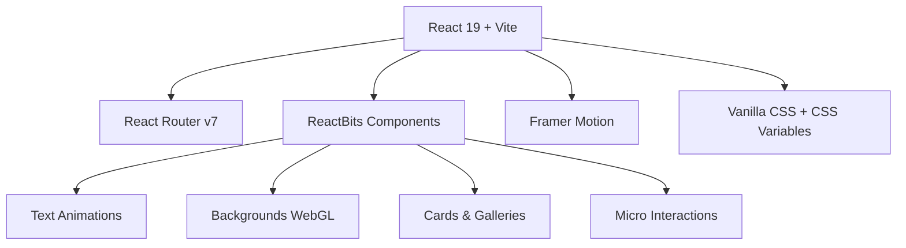
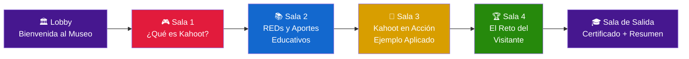
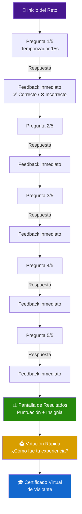
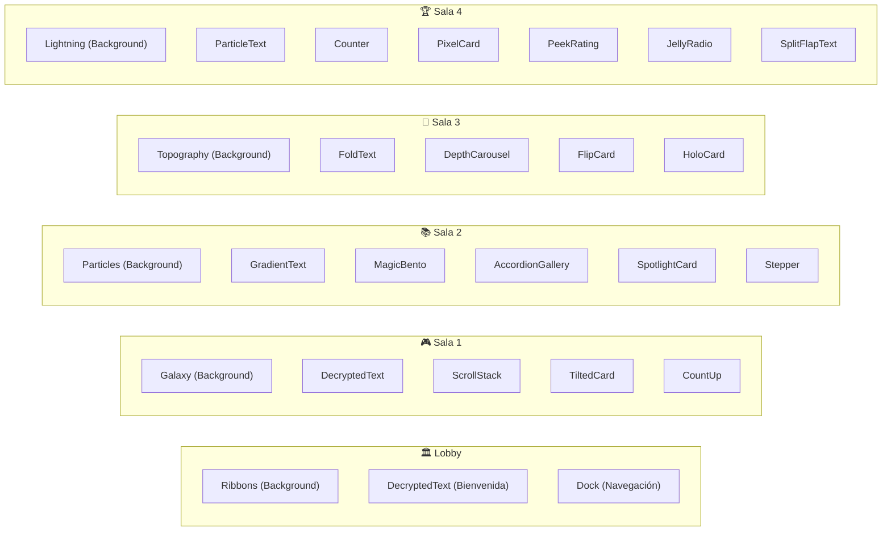

# 🏛️ Plan Estratégico y Técnico — Museo Interactivo Virtual
## *"Kahoot: El Poder de la Gamificación en la Educación"*

> **Temática:** Tecnología Educativa  
> **Herramienta Digital:** Kahoot  
> **Stack Técnico:** React 19 + Vite + ReactBits  
> **Tipo de Proyecto:** Exposición virtual inmersiva con 4 salas interactivas

---

## 📋 Tabla de Contenidos

1. [Visión General del Proyecto](#1-visión-general-del-proyecto)
2. [Arquitectura Técnica](#2-arquitectura-técnica)
3. [Diseño de las 4 Salas del Museo](#3-diseño-de-las-4-salas-del-museo)
4. [Componentes ReactBits por Sala](#4-componentes-reactbits-por-sala)
5. [Plan de Desarrollo por Fases](#5-plan-de-desarrollo-por-fases)
6. [Estructura de Archivos del Proyecto](#6-estructura-de-archivos-del-proyecto)
7. [Contenido Educativo Detallado](#7-contenido-educativo-detallado)
8. [Estrategia de UX/UI Inmersiva](#8-estrategia-de-uxui-inmersiva)

---

## 1. Visión General del Proyecto

### 🎯 Objetivo
Crear un **museo interactivo virtual** que explore **Kahoot** como herramienta digital educativa, dentro del contexto de la **tecnología educativa**. El museo debe ser una experiencia didáctica atractiva que transforme recursos digitales en una vivencia inmersiva para el visitante.

### 🧩 Requisitos del Proyecto (según instrucciones)

| Requisito | Implementación |
|-----------|---------------|
| Mínimo 4 salas | ✅ 4 salas temáticas completas |
| Cada sala: herramienta digital + importancia | ✅ Kahoot como eje central en cada sala |
| Mínimo 5 RED (Recursos Educativos Digitales) | ✅ 7 REDs distribuidos entre las salas |
| Actividad para el visitante | ✅ Quiz interactivo + votación rápida en Sala 4 |
| Reto final (quiz + votación) | ✅ Sala 4 dedicada al reto inmersivo |

### 🎨 Filosofía de Diseño
- **Inmersivo**: Fondos animados WebGL, transiciones fluidas entre salas
- **Dinámico**: Micro-interacciones en cada elemento, respuesta al cursor
- **Atrayente**: Paleta de colores vibrante inspirada en Kahoot (púrpura, verde, rojo, naranja, azul)
- **Educativo**: Contenido claro, bien estructurado y visualmente accesible

---

## 2. Arquitectura Técnica

### Stack Tecnológico



### Dependencias Principales

| Paquete | Versión | Propósito |
|---------|---------|-----------|
| `react` | ^19.x | Framework principal |
| `react-dom` | ^19.x | Renderizado DOM |
| `react-router-dom` | ^7.x | Navegación entre salas |
| `react-bits` | latest | Componentes animados premium |
| `framer-motion` | ^12.x | Animaciones de transición entre salas |
| `lucide-react` | latest | Iconografía |

### Comando de Inicialización
```bash
npx -y create-vite@latest ./ -- --template react
npm install react-router-dom framer-motion lucide-react react-bits
```

---

## 3. Diseño de las 4 Salas del Museo

### 🗺️ Mapa del Museo



---

### 🎮 SALA 1 — "¿Qué es Kahoot?"
**Subtítulo:** *La herramienta que revolucionó la gamificación educativa*

| Aspecto | Detalle |
|---------|---------|
| **Objetivo** | Presentar Kahoot: qué es, cómo funciona, historia y filosofía |
| **Fondo WebGL** | `Galaxy` — Vuelo infinito a través de estrellas (sensación de exploración) |
| **Paleta** | Púrpura Kahoot `#46178F` + acentos `#E21B3C` |
| **RED #1** | Infografía interactiva: "Timeline de Kahoot" (desde 2012 hasta hoy) |
| **RED #2** | Video incrustado: "Cómo funciona Kahoot en el aula" |
| **Contenido** | Historia, fundadores, millones de usuarios, premios, impacto global |

**Componentes ReactBits seleccionados:**
- `DecryptedText` → Título "¿Qué es Kahoot?" que se descifra al entrar
- `SplitText` → Subtítulos con entrada escalonada
- `ScrollStack` → Cards apiladas con la historia de Kahoot año por año
- `TiltedCard` → Tarjeta 3D con logo y datos clave de Kahoot
- `CountUp` → Estadísticas animadas (300M+ jugadores, 10B+ sesiones)
- `AnimatedContent` → Revelado de secciones al hacer scroll
- `StarBorder` → Bordes con estrella viajera en los botones de navegación

---

### 📚 SALA 2 — "Recursos Educativos Digitales"
**Subtítulo:** *Para qué sirve Kahoot didácticamente*

| Aspecto | Detalle |
|---------|---------|
| **Objetivo** | Mostrar para qué sirve Kahoot didácticamente, sus aportes educativos |
| **Fondo WebGL** | `Particles` — Campo 3D de partículas con líneas de constelación |
| **Paleta** | Azul Kahoot `#1368CE` + blanco + cyan claro |
| **RED #3** | Mapa conceptual interactivo: "Aportes de Kahoot a la educación" |
| **RED #4** | Carrusel de casos de uso: evaluación formativa, repaso, encuestas |
| **Contenido** | Gamificación, motivación, retroalimentación inmediata, inclusión, trabajo colaborativo |

**Componentes ReactBits seleccionados:**
- `GradientText` → Título con gradiente animado azul-cyan
- `BlurText` → Texto que se desenfoca y aclara suavemente
- `MagicBento` → Grid Bento para mostrar los 5 aportes educativos en cards con arte vivo
- `AccordionGallery` → Paneles expandibles con cada aporte educativo
- `SpotlightCard` → Cards iluminadas por spotlight que sigue al cursor
- `ClickSpark` → Chispas al hacer clic en elementos interactivos
- `Stepper` → Flujo paso a paso mostrando "Cómo crear un Kahoot"
- `FadeContent` → Contenido que se revela suavemente al scroll

---

### 🧪 SALA 3 — "Kahoot en Acción"
**Subtítulo:** *Ejemplo aplicado de tecnología educativa*

| Aspecto | Detalle |
|---------|---------|
| **Objetivo** | Mostrar un ejemplo concreto de Kahoot aplicado con la temática de tecnología educativa |
| **Fondo WebGL** | `Topography` — Paisaje 3D de líneas de contorno brillantes |
| **Paleta** | Naranja/Dorado Kahoot `#D89E00` + ámbar + crema |
| **RED #5** | Demo paso a paso: "Creando un Kahoot sobre seguridad digital" |
| **RED #6** | Galería de capturas: screenshots reales de un Kahoot funcionando |
| **Contenido** | Tutorial visual, resultados de aprendizaje, métricas de engagement |

**Componentes ReactBits seleccionados:**
- `FoldText` → Título que se despliega como papel
- `ShinyText` → Texto brillante cromado para subtítulos
- `DepthCarousel` → Carrusel 3D con capturas de pantalla del ejemplo
- `FlipCard` → Tarjetas que giran para mostrar pregunta ↔ respuesta
- `PixelTransition` → Transición pixelada entre vistas del tutorial
- `Carousel` → Slider con pasos del tutorial
- `HoloCard` → Tarjeta holográfica con el "ejemplo estrella" del Kahoot
- `GlareHover` → Brillo que sigue al cursor en las imágenes

---

### 🏆 SALA 4 — "El Reto del Visitante"
**Subtítulo:** *¡Demuestra lo que aprendiste!*

> [!IMPORTANT]
> Esta sala es el **elemento diferenciador** del museo. Debe ser la experiencia más inmersiva y memorable, convirtiendo al visitante pasivo en participante activo.

| Aspecto | Detalle |
|---------|---------|
| **Objetivo** | Quiz de 5 preguntas + votación rápida para evaluar la experiencia |
| **Fondo WebGL** | `Lightning` — Relámpagos que se intensifican con cada respuesta correcta |
| **Paleta** | Verde Kahoot `#26890C` + dorado para logros + rojo para errores |
| **RED #7** | Quiz gamificado completo con sistema de puntos y feedback |
| **Contenido** | 5 preguntas tipo quiz + votación con insignias/emoticones |

**Componentes ReactBits seleccionados:**
- `ParticleText` → "EL RETO" se forma de partículas flotantes
- `GlitchText` → Efecto glitch en el título para intensidad
- `Counter` → Odómetro de puntuación que rueda en tiempo real
- `PixelCard` → Cards de opciones que brillan con píxeles al hover
- `HoldButton` → Botón de confirmación "hold-to-confirm" para respuestas
- `PulseHeart` → Botón de "Me encantó" con animación de pulso
- `PeekRating` → Sistema de estrellas animado para calificar
- `JellyRadio` → Chips de selección que se inflan al elegir
- `SplitFlapText` → Tablero split-flap que revela la respuesta correcta
- `SloshGauge` → Medidor de "nivel de conocimiento" que se llena
- `SwipeToast` → Notificaciones de "¡Correcto!" / "¡Incorrecto!"
- `ElectricBorder` → Bordes eléctricos en la card ganadora
- `ConfettiExplosion` → Explosión de confeti al completar el reto (CSS custom)

#### 🎯 Mecánica del Reto



#### 📝 Las 5 Preguntas del Quiz

| # | Pregunta | Opciones | Respuesta |
|---|----------|----------|-----------|
| 1 | ¿En qué año fue fundado Kahoot? | 2010 / **2012** / 2015 / 2018 | 2012 |
| 2 | ¿Qué tipo de aprendizaje promueve Kahoot principalmente? | Memorístico / **Gamificación** / Conductista / Magistral | Gamificación |
| 3 | ¿Cuál es una ventaja clave de Kahoot en el aula? | Solo funciona con internet / **Retroalimentación inmediata** / Requiere licencia costosa / Solo sirve para matemáticas | Retroalimentación inmediata |
| 4 | ¿Qué tipo de contenido NO se puede crear en Kahoot? | Quizzes / Encuestas / **Documentos de texto** / Presentaciones | Documentos de texto |
| 5 | ¿Cuántos jugadores ha alcanzado Kahoot a nivel mundial? | 50 millones / 100 millones / **Más de 300 millones** / 10 millones | Más de 300 millones |

#### 🏅 Sistema de Insignias

| Puntuación | Insignia | Emoticón | Mensaje |
|-----------|----------|----------|---------|
| 5/5 | 🏆 Maestro Kahoot | 🌟 | "¡Eres un experto en tecnología educativa!" |
| 4/5 | 🥇 Explorador Avanzado | 🎯 | "¡Casi perfecto! Gran conocimiento." |
| 3/5 | 🥈 Aprendiz Digital | 📚 | "¡Buen trabajo! Sigue explorando." |
| 2/5 | 🥉 Visitante Curioso | 🔍 | "Te invitamos a recorrer el museo de nuevo." |
| 0-1/5 | 🎫 Principiante | 💡 | "¡Cada visita es una oportunidad de aprender!" |

#### 🗳️ Votación Rápida (Evaluación de Experiencia)

Al finalizar el quiz, el visitante encontrará una votación con 3 preguntas rápidas:

1. **¿Cómo calificas tu experiencia en el museo?** → `PeekRating` (1-5 estrellas animadas)
2. **¿Qué sala te gustó más?** → `JellyRadio` (chips con las 4 salas)
3. **¿Recomendarías este museo?** → `PulseHeart` (botón animado Sí/No)

---

## 4. Componentes ReactBits por Sala — Resumen Visual



---

## 5. Plan de Desarrollo por Fases

### Fase 1 — Fundación (Estructura Base)
> **Objetivo:** Proyecto funcional con navegación y layout base

- [ ] Inicializar proyecto React + Vite
- [ ] Instalar dependencias (react-router-dom, framer-motion, react-bits)
- [ ] Configurar React Router con rutas para cada sala
- [ ] Crear el sistema de diseño CSS (variables, tipografía, paleta Kahoot)
- [ ] Implementar layout principal con navegación lateral/dock
- [ ] Crear componente `<MuseumShell>` como wrapper de las salas

### Fase 2 — Lobby y Navegación
> **Objetivo:** Entrada espectacular al museo con navegación fluida

- [ ] Implementar página de bienvenida (Lobby) con background `Ribbons`
- [ ] Título con `DecryptedText` que se descifra al entrar
- [ ] Navegación tipo `Dock` (macOS style) para acceder a las salas
- [ ] Transiciones animadas entre salas con Framer Motion
- [ ] Indicador de progreso del recorrido

### Fase 3 — Sala 1: ¿Qué es Kahoot?
> **Objetivo:** Presentación inmersiva de la herramienta

- [ ] Background `Galaxy` con interacción de cursor
- [ ] Contenido educativo: historia, filosofía, datos
- [ ] `ScrollStack` con timeline de Kahoot
- [ ] `TiltedCard` con datos clave
- [ ] `CountUp` con estadísticas animadas
- [ ] RED #1: Infografía interactiva del timeline
- [ ] RED #2: Video embebido explicativo

### Fase 4 — Sala 2: Recursos Educativos Digitales
> **Objetivo:** Explicar los aportes educativos de Kahoot

- [ ] Background `Particles` con líneas de constelación
- [ ] `MagicBento` grid con los 5 aportes educativos
- [ ] `AccordionGallery` con detalles expandibles
- [ ] `Stepper` para "Cómo crear un Kahoot"
- [ ] RED #3: Mapa conceptual interactivo
- [ ] RED #4: Carrusel de casos de uso

### Fase 5 — Sala 3: Kahoot en Acción
> **Objetivo:** Ejemplo práctico aplicado

- [ ] Background `Topography` con contornos brillantes
- [ ] `DepthCarousel` con capturas del ejemplo
- [ ] `FlipCard` con preguntas/respuestas de ejemplo
- [ ] `HoloCard` con el ejemplo estrella
- [ ] RED #5: Demo paso a paso
- [ ] RED #6: Galería de capturas

### Fase 6 — Sala 4: El Reto del Visitante ⭐
> **Objetivo:** Experiencia gamificada culminante

- [ ] Background `Lightning` con intensidad reactiva
- [ ] Sistema de quiz completo con 5 preguntas
- [ ] Temporizador visual por pregunta (15 segundos)
- [ ] `Counter` con puntuación en tiempo real
- [ ] `SplitFlapText` para revelar respuestas
- [ ] Feedback animado (correcto/incorrecto) con `SwipeToast`
- [ ] Sistema de insignias con animación
- [ ] Votación rápida con `PeekRating`, `JellyRadio`, `PulseHeart`
- [ ] RED #7: Quiz gamificado completo
- [ ] Pantalla de resultados con certificado virtual

### Fase 7 — Pulido y Optimización
> **Objetivo:** Experiencia premium sin errores

- [ ] Responsive design (móvil, tablet, desktop)
- [ ] Optimización de rendimiento (lazy loading, code splitting)
- [ ] Accesibilidad (ARIA labels, navegación por teclado)
- [ ] Pruebas de usabilidad
- [ ] SEO meta tags
- [ ] Deploy final

---

## 6. Estructura de Archivos del Proyecto

```
museo-interactivo-kahoot/
├── public/
│   ├── favicon.ico
│   ├── images/
│   │   ├── kahoot-logo.png
│   │   ├── sala1/               # Imágenes de Sala 1
│   │   ├── sala2/               # Imágenes de Sala 2
│   │   ├── sala3/               # Imágenes de Sala 3
│   │   └── badges/              # Insignias del reto
│   └── videos/
│       └── kahoot-demo.mp4
├── src/
│   ├── main.jsx                 # Entry point
│   ├── App.jsx                  # Router principal
│   ├── index.css                # Design system global
│   ├── components/
│   │   ├── layout/
│   │   │   ├── MuseumShell.jsx  # Wrapper principal del museo
│   │   │   ├── Navbar.jsx       # Navegación entre salas (Dock)
│   │   │   ├── ProgressBar.jsx  # Barra de progreso del recorrido
│   │   │   └── RoomTransition.jsx # Animación de transición
│   │   ├── shared/
│   │   │   ├── SectionTitle.jsx # Título reutilizable con efectos
│   │   │   ├── InfoCard.jsx     # Card informativa reutilizable
│   │   │   ├── StatCounter.jsx  # Contador de estadísticas
│   │   │   └── VideoEmbed.jsx   # Componente de video
│   │   ├── sala4/
│   │   │   ├── QuizEngine.jsx   # Motor del quiz
│   │   │   ├── QuestionCard.jsx # Card de pregunta individual
│   │   │   ├── Timer.jsx        # Temporizador visual
│   │   │   ├── ScoreBoard.jsx   # Tablero de puntuación
│   │   │   ├── BadgeReveal.jsx  # Revelación de insignia
│   │   │   ├── VotingSection.jsx # Sección de votación
│   │   │   └── Certificate.jsx  # Certificado virtual
│   │   └── ui/
│   │       ├── Button.jsx       # Botón reutilizable con efectos
│   │       └── Modal.jsx        # Modal reutilizable
│   ├── pages/
│   │   ├── Lobby.jsx            # Página de bienvenida
│   │   ├── Sala1.jsx            # ¿Qué es Kahoot?
│   │   ├── Sala2.jsx            # REDs y Aportes
│   │   ├── Sala3.jsx            # Kahoot en Acción
│   │   ├── Sala4.jsx            # El Reto del Visitante
│   │   └── Exit.jsx             # Sala de salida
│   ├── data/
│   │   ├── quizQuestions.js     # Datos del quiz
│   │   ├── badges.js            # Definición de insignias
│   │   ├── kahootTimeline.js    # Timeline histórico
│   │   └── educationalContent.js # Contenido educativo
│   ├── hooks/
│   │   ├── useQuiz.js           # Hook del motor de quiz
│   │   ├── useTimer.js          # Hook del temporizador
│   │   └── useProgress.js       # Hook del progreso del museo
│   └── utils/
│       └── animations.js        # Configuraciones de animación
├── package.json
├── vite.config.js
└── README.md
```

---

## 7. Contenido Educativo Detallado

### Sala 1 — ¿Qué es Kahoot?

> **Kahoot!** es una plataforma de aprendizaje basada en juegos, fundada en **2012** en Noruega por Johan Brand, Jamie Brooker y Morten Versvik, en colaboración con el profesor Alf Inge Wang de la Universidad Noruega de Ciencia y Tecnología (NTNU).

**Datos clave para los contadores animados (`CountUp`):**
- 🌍 **300M+** de participantes únicos
- 🏫 **200+** países donde se usa
- 📱 **10B+** participaciones acumuladas
- ⭐ **#1** plataforma de gamificación educativa

**Timeline para `ScrollStack`:**
- **2012** — Nace como proyecto universitario en NTNU, Noruega
- **2013** — Lanzamiento público como plataforma gratuita
- **2017** — Supera los 50 millones de jugadores
- **2019** — Adquiere Poio Education y Drops (idiomas)
- **2020** — Boom durante la pandemia: educación remota
- **2021** — Se convierte en empresa pública (NYSE: KHAT)
- **2024** — Integra IA para crear quizzes automáticamente

### Sala 2 — Los 5 Aportes Educativos de Kahoot

Para el **MagicBento Grid**, cada celda representa un aporte:

| # | Aporte | Icono | Descripción |
|---|--------|-------|-------------|
| 1 | 🎮 **Gamificación** | Gamepad | Transforma el aprendizaje en una experiencia lúdica con puntos, ranking y competencia sana |
| 2 | 💡 **Retroalimentación Inmediata** | Zap | El estudiante sabe al instante si acertó o erró, reforzando el aprendizaje |
| 3 | 🤝 **Aprendizaje Colaborativo** | Users | Modo equipo permite trabajo grupal y discusión entre pares |
| 4 | 📊 **Evaluación Formativa** | BarChart | Los docentes obtienen datos en tiempo real del desempeño grupal e individual |
| 5 | 🌐 **Inclusión Digital** | Globe | Funciona en cualquier dispositivo con navegador, sin instalación |

### Sala 3 — Ejemplo Práctico

**Título del ejemplo:** *"Quiz de Seguridad Digital para estudiantes de secundaria"*

Paso a paso para el `Stepper` / `Carousel`:
1. **Crear cuenta** en kahoot.com
2. **Elegir tipo**: Quiz de opción múltiple
3. **Agregar preguntas** sobre seguridad digital (phishing, contraseñas, privacidad)
4. **Configurar** temporizador y puntuación
5. **Compartir PIN** del juego con los estudiantes
6. **Jugar en vivo** — Los estudiantes responden desde sus dispositivos
7. **Revisar resultados** — Dashboard con estadísticas de aprendizaje

---

## 8. Estrategia de UX/UI Inmersiva

### 🎨 Paleta de Colores (inspirada en Kahoot)

```css
:root {
  /* Colores principales Kahoot */
  --kahoot-purple:  #46178F;   /* Lobby + marca */
  --kahoot-red:     #E21B3C;   /* Sala 1 + errores */
  --kahoot-blue:    #1368CE;   /* Sala 2 */
  --kahoot-yellow:  #D89E00;   /* Sala 3 */
  --kahoot-green:   #26890C;   /* Sala 4 + aciertos */
  
  /* Neutros */
  --bg-dark:        #0a0a0f;
  --bg-surface:     #1a1a2e;
  --text-primary:   #ffffff;
  --text-secondary: #b4b4cc;
  
  /* Efectos */
  --glow-purple:    rgba(70, 23, 143, 0.4);
  --glow-green:     rgba(38, 137, 12, 0.4);
}
```

### 🔤 Tipografía

| Uso | Fuente | Peso |
|-----|--------|------|
| Títulos principales | **Bricolage Grotesque** | 700-800 |
| Subtítulos | **Inter** | 600 |
| Cuerpo de texto | **Inter** | 400 |
| Código/datos | **JetBrains Mono** | 400 |

### 🌊 Transiciones entre Salas

Cada cambio de sala utiliza una combinación de:
- **Framer Motion** `AnimatePresence` con variantes de page transition
- **Pixel Transition** de ReactBits como efecto de "disolución"
- Cambio gradual del background WebGL

### 📱 Responsive Breakpoints

| Breakpoint | Dispositivo | Adaptaciones |
|-----------|-------------|--------------|
| `< 480px` | Móvil | Stack vertical, fondos simplificados, dock inferior |
| `480-768px` | Tablet | Grid 2 columnas, dock lateral compacto |
| `768-1024px` | Tablet grande | Grid 3 columnas |
| `> 1024px` | Desktop | Experiencia completa con todos los efectos |

---

> [!TIP]
> **Recomendación para maximizar impacto:** La Sala 4 (El Reto) debería ocupar al menos el **40% del esfuerzo de desarrollo** ya que es el elemento que convierte al visitante de observador pasivo a participante activo, que es la esencia de un museo interactivo.

---

> [!NOTE]
> Este plan cubre todos los requisitos del archivo de instrucciones:
> - ✅ 4 salas del museo con contenido sobre Kahoot
> - ✅ 7 Recursos Educativos Digitales (mínimo 5 requeridos)
> - ✅ Reto interactivo con quiz de 5 preguntas + votación con insignias
> - ✅ Componentes de ReactBits integrados en todas las salas
> - ✅ Experiencia dinámica, inmersiva y atrayente
> - ✅ Herramienta digital elegida: **Kahoot**
> - ✅ Temática: **Tecnología Educativa**

---

*Plan elaborado para el desarrollo del Museo Interactivo Virtual — React + Vite + ReactBits*
